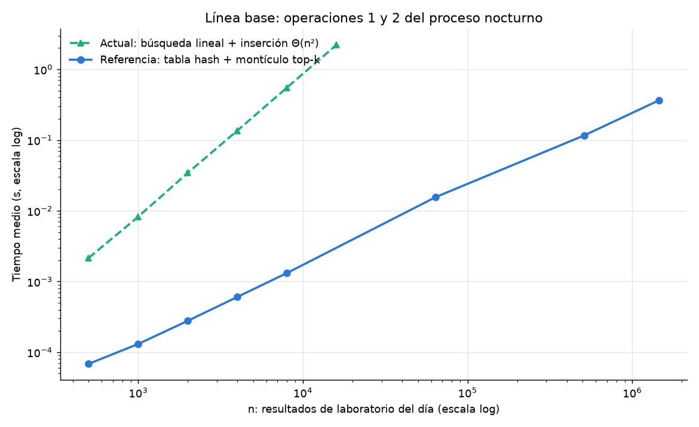
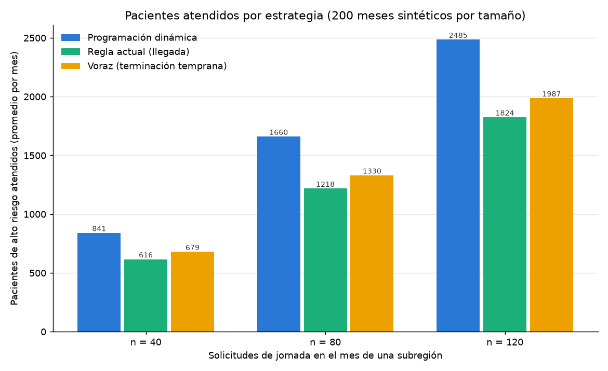
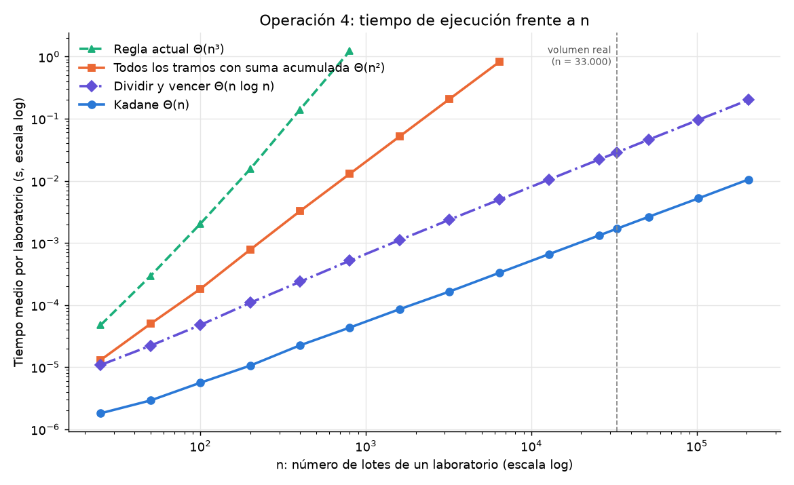
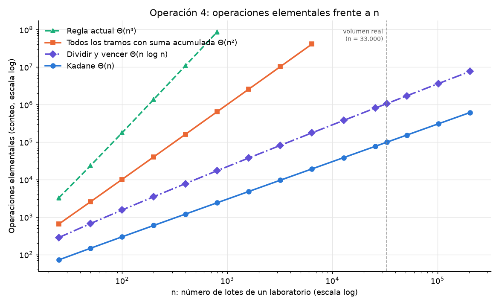

# Plataforma Pulso: consolidación, priorización y agendamiento del tamizaje de diabetes

**Informe técnico — Proyecto final de Análisis de Algoritmos (2026-2)**

| | |
| --- | --- |
| **Caso asignado** | Caso 2 — Plataforma Pulso (Secretaría de Salud departamental) |
| **Integrantes** | Sebastian Villa Castillo · Jhon Eduardo Zabala Garzon · Brayan Alexis Arango Orrego · David Morales Vargas |
| **Operaciones trabajadas** | Op. 3 — Programación de las jornadas de las unidades móviles (Laboratorio 4) · Op. 4 — Vigilancia de la calidad de los laboratorios |

**Resumen.**
- **Op. 3 (jornadas):** la Secretaría asigna hoy por orden de llegada. Proponemos programación dinámica de intervalos ponderados, que maximiza los pacientes de alto riesgo atendidos. En meses sintéticos atiende un **36 % más de pacientes** que la regla actual, en menos de un milisegundo por mes.
- **Op. 4 (vigilancia):** el programa actual revisa todos los tramos de lotes y tarda días. Proponemos el algoritmo de Kadane (Θ(n)) y lo contrastamos con dividir y vencer (Θ(n log n)). Los 290 laboratorios se procesan en **menos de un segundo**.
- **Línea base:** las operaciones 1 y 2 consumen hoy cerca de **971 kWh al año**, la mayor parte de la energía del proceso, y ninguna cabe en la ventana nocturna.

---

## 1. Análisis del problema

### 1.1 Descripción del problema computacional

La Secretaría recibe cada día unos **1.450.000 resultados** de tamizaje enviados por 290 laboratorios e IPS. Con ellos hace cuatro cosas:
1. **Consolidar** un resultado por paciente.
2. Armar la **lista diaria de 9.000 llamadas**, en orden de riesgo.
3. **Programar las jornadas** de 9 unidades móviles.
4. **Vigilar** a los laboratorios para detectar equipos descalibrados.

La plataforma se diseñó para 35.000 registros. El volumen creció unas 40 veces, y las estrategias cuadráticas o cúbicas dejaron de caber en el tiempo disponible: el proceso nocturno tarda unas 7 h y la ventana es de 4 h. La programación de jornadas se hace a mano y la vigilancia tarda días.

El problema computacional es elegir, para cada operación, una estrategia que:
- dé **el mismo resultado exacto** que exige el negocio;
- termine dentro de la ventana;
- consuma la menor energía posible en un único servidor de 380 W, sin paralelismo.

### 1.2 Entradas, salidas y restricciones

#### Operación 3 — Programación de las jornadas de las unidades móviles

| Elemento | Descripción |
| --- | --- |
| **Entrada** | Solicitudes del mes de una subregión, en orden de llegada. Cada una es una tupla `(inicio, fin, pacientes)`: inicio y fin en minutos desde el inicio del mes, con `fin > inicio` y el desplazamiento incluido; `pacientes` es el número de pacientes de alto riesgo pendientes en el municipio (entero ≥ 0) |
| **Tamaño** | n = 40 a 120 solicitudes por subregión y mes; 9 subregiones (9 instancias independientes por mes) |
| **Salida** | El subconjunto de solicitudes aceptadas, ordenado por hora de inicio, que **maximiza el total de pacientes de alto riesgo atendidos** |
| **Restricciones** | La programación de una unidad nunca tiene dos jornadas que se crucen. El resultado es el máximo, no una aproximación. Las solicitudes originales no se modifican |

**Por qué maximizar pacientes y no jornadas.** Según el caso, con la regla actual *"cada mes quedan sin atender municipios con muchos pacientes de alto riesgo"*. El objetivo del programa es valorar a la mayor cantidad de personas en riesgo, no hacer muchas jornadas. Un municipio con 60 pacientes pendientes no vale lo mismo que uno con 3.

La sección 4.1 muestra además que optimizar pacientes **no cuesta más** que optimizar jornadas: ambas estrategias son Θ(n log n).

Quién debe tomar esta decisión se discute en la sección 6.2.

#### Operación 4 — Vigilancia de la calidad de los laboratorios

| Elemento | Descripción |
|---|---|
| **Entrada** | Para cada laboratorio, la serie cronológica de sus lotes. Cada lote aporta `x_i` = (tasa de positivos − tasa esperada) × 1000, en puntos por mil (entero, puede ser negativo). Un positivo es un índice de riesgo ≥ 70 |
| **Tamaño** | n ≈ 33.000 lotes por laboratorio (30 lotes/día × 3 años); 290 laboratorios |
| **Salida** | `(suma, inicio, fin)`: el tramo de lotes consecutivos con mayor exceso acumulado de positivos |
| **Restricciones** | El tramo reportado es el de **mayor** exceso, no una aproximación. La serie original no se modifica |

#### Operaciones 1 y 2 (solo para la línea base)

- **Op. 1:**
  - Entrada: 1.450.000 resultados `(documento, fecha, riesgo)`.
  - Salida: un resultado por paciente, el más reciente.
  - Restricción: ningún paciente desaparece.
- **Op. 2:**
  - Entrada: los pacientes consolidados.
  - Salida: los 9.000 de mayor riesgo; a igual riesgo, primero el resultado más antiguo.

### 1.3 Operaciones críticas del proceso

| Op. | Estrategia actual | Complejidad | n real | Tiempo actual estimado | ¿Cabe? |
|---|---|---|---|---|---|
| 1. Consolidación | Busca cada resultado recorriendo la lista consolidada | Θ(n·m) ≈ Θ(n²) | 1.450.000 | ops. 1 + 2: **≈ 5,1 h medido y extrapolado**; **7 h** según la Secretaría | **No** (ventana 4 h) |
| 2. Lista de llamadas | Ordena todo por inserción y toma 9.000 | Θ(n²) | ≈ 1.276.000 pacientes | (incluido arriba) | **No** |
| 3. Jornadas | A mano: orden de llegada, rechaza cruces | Θ(n²) | 120 por subregión | < 1 ms en cómputo; días de trabajo manual en hojas de cálculo | Sí (cómputo) |
| 4. Vigilancia | Evalúa todos los tramos, sumando cada uno | Θ(n³) | 33.000 × 290 | **"varios días"** según el cliente; ≈ 290 días en nuestra implementación en Python | **No** |

Las operaciones más costosas son la **4** (cúbica) y la pareja **1 + 2** (cuadráticas sobre 1,45 millones de registros):
- La pareja 1 + 2 es la que desborda la ventana nocturna cada día.
- La op. 4 ni siquiera puede ejecutarse con la frecuencia que la vigilancia necesitaría.

La op. 3 tiene un costo de cómputo despreciable. Su costo es **social**: pacientes de alto riesgo que se quedan sin valoración.

Los valores de las ops. 1 y 2 salen de [`src/linea_base/medicion.py`](src/linea_base/medicion.py) (ver [`resultados/linea_base/resumen.md`](resultados/linea_base/resumen.md)). Se midieron las implementaciones actuales hasta n = 16.000 y se extrapoló con T(n) = c·n²; el factor medido al duplicar n fue **4,03** (esperado 4).



### 1.4 Costo energético del proceso actual (línea base)

Energía = potencia × tiempo. El servidor consume **0,38 kW**.

| Operación | Tiempo por ejecución | Ejecuciones/año | kWh/año |
|---|---|---|---|
| Ops. 1 + 2 (cifra de la Secretaría) | 7 h | 365 noches | 0,38 × 7 × 365 = **970,9** |
| Ops. 1 + 2 (nuestra extrapolación) | 5,07 h | 365 | 702,9 |
| Op. 4 (supuesto: "varios días" = 3 días = 72 h) | 72 h | 12 (mensual; a diario no cabe) | 0,38 × 72 × 12 = **328,3** |
| Op. 3 | < 1 ms | 108 | ≈ 0 (el costo es humano, no eléctrico) |
| **Total línea base** | | | **≈ 1.299 kWh/año** |

Nuestra extrapolación de las ops. 1 + 2 (5,1 h) es del mismo orden que las 7 h que informa la Secretaría, lo que respalda la forma cuadrática del costo. Para la línea base usamos la cifra del cliente, que es la real.

### 1.5 Supuestos

**Generales** (permitidos por el enunciado):
- Datos válidos.
- Todo cabe en memoria.
- Un solo hilo de ejecución.
- Sin interfaz ni base de datos.
- Datos sintéticos de tamaño creciente con semilla fija, y extrapolación al volumen real.

**Operación 3:**
1. Dos jornadas que **se tocan en un extremo** (una termina justo cuando la otra empieza) **no se cruzan**, porque la hora de fin ya incluye el desplazamiento. La regla vive en un único lugar, [`modelo.se_cruzan`](src/jornadas_unidades/modelo.py), y en el `<=` de la búsqueda binaria.
2. **Regla actual:** se recorren las solicitudes en el orden de la lista (orden de llegada) y se acepta cada una que no se cruce con ninguna ya aceptada. Nunca se revoca una aceptación.
3. Cada subregión se programa por separado, con una unidad por subregión.
4. Una solicitud con 0 pacientes es válida. Si hay varios óptimos con el mismo valor, cualquiera es correcto.
5. Datos sintéticos ([`datos.py`](src/jornadas_unidades/datos.py)):
   - Unas 4 solicitudes por día, la densidad del mes más cargado (120 en 30 días).
   - Inicio entre las 06:00 y las 16:00 y duración de 2 a 10 h, en pasos de 30 min.
   - De 1 a 80 pacientes por solicitud.

**Operación 4:**
1. Los valores son enteros en puntos por mil, para evitar errores de redondeo con decimales.
2. El tramo nunca es vacío. Si todos los lotes son negativos, el tramo es el lote con el valor más alto. Una serie vacía devuelve `(0, 0, -1)`, que indica que no hay tramo.
3. **Regla actual:** para cada pareja (inicio, fin) se vuelve a sumar el tramo desde cero, lo que da Θ(n³). Es la lectura coherente con que el programa tarde "varios días".
4. Si hay empate entre tramos con la misma suma, se acepta cualquiera.
5. Datos sintéticos ([`datos.py`](src/vigilancia_laboratorios/datos.py)):
   - Ruido normal de media 0 y desviación de 40 puntos por mil.
   - Cada ~5.000 lotes, un episodio de descalibración de 20 a 200 lotes con +25 puntos por mil.
6. La vigilancia con la estrategia propuesta se ejecuta **una vez al día** (365 al año).

**Línea base:**
- Entre el 8 % y el 15 % de los resultados son de pacientes repetidos; usamos 12 %.
- Las fechas son distintas por paciente.
- Si la Secretaría dice que la vigilancia tarda "varios días", tomamos 3 días.

---

## 2. Diseño de la solución

### 2.1 Estructuras de datos

| Estructura | Dónde | Por qué |
|---|---|---|
| Tupla inmutable `(inicio, fin, pacientes)` | Op. 3 | Representa una solicitud. Al ser inmutable, ningún algoritmo puede alterar el registro original (trazabilidad) |
| Lista ordenada por fin | Op. 3, PD y voraz | Con ese orden, las jornadas compatibles con j forman un bloque al principio de la lista y el estado de la PD es un solo número |
| Arreglo `p[0..n]` | Op. 3 | p(j) = cuántas jornadas anteriores terminan antes de que j empiece. Se calcula con búsqueda binaria |
| Tabla `M[0..n]` | Op. 3 | M[j] = máximo de pacientes usando las jornadas 1..j. Se llena una vez y sirve para reconstruir |
| Lista de enteros `x[0..n−1]` | Op. 4 | La serie de lotes. Se recorre una sola vez (Kadane) |
| Variables `E` y `mejor` | Op. 4, Kadane | Basta el valor anterior de la recurrencia: espacio Θ(1) |
| Pila de recursión | Op. 4, dividir y vencer | Profundidad ⌈log₂ n⌉ ≈ 16 para n = 33.000 |
| Tabla hash `documento → posición` | Op. 1 (referencia) | Busca un paciente en Θ(1) esperado, en lugar de recorrer la lista |
| Montículo de tamaño k | Op. 2 (referencia) | Selecciona los 9.000 de mayor riesgo en Θ(n log k) sin ordenar todo |

### 2.2 Operación 3 — Estrategias

| Estrategia | Familia | Objetivo | Archivo |
|---|---|---|---|
| **Intervalos ponderados (recomendada)** | Programación dinámica | Máximo de pacientes | [`estrategia.py`](src/jornadas_unidades/estrategia.py) |
| Exhaustiva | Fuerza bruta (verificador exacto) | Máximo de pacientes | [`exhaustivo.py`](src/jornadas_unidades/exhaustivo.py) |
| Orden de llegada (actual) | Voraz ingenua | Ninguno explícito | [`regla_actual.py`](src/jornadas_unidades/regla_actual.py) |
| Terminación más temprana | Voraz | Máximo de **jornadas** | [`estrategia.py`](src/jornadas_unidades/estrategia.py) (`terminacion_temprana`) |

#### Por qué el problema admite programación dinámica

Se ordenan las solicitudes por hora de fin y se numeran 1..n. Para la última jornada j solo hay dos opciones:
- **No aceptarla.** Entonces la mejor programación es la mejor entre las jornadas 1..j−1.
- **Aceptarla.** Entonces se ganan sus v_j pacientes, pero solo se le pueden sumar jornadas que terminen antes de que j empiece. Como la lista está ordenada por fin, esas jornadas son exactamente las 1..p(j), y lo mejor que se puede sumar es la mejor programación de ese prefijo.

Hay **subestructura óptima**: en ambos casos, la solución óptima del problema contiene una solución óptima de un prefijo más pequeño. Si contuviera una programación peor de ese prefijo, se podría reemplazar por la óptima y mejorar el total, lo que es una contradicción.

Hay **subproblemas traslapados**: los mismos prefijos se consultan muchas veces.
- En el ejemplo de abajo, M[3] lo usan tanto la jornada 5 como la 6, y cada M[j−1] se consulta en el paso j.
- Una recursión sin tabla resolvería los mismos prefijos una y otra vez, con costo exponencial.
- Con la tabla, cada prefijo se resuelve **una vez**.

**¿Por qué no basta un voraz?** La propiedad de elección voraz ("aceptar primero la que termina antes") garantiza el máximo de **jornadas**, porque deja la unidad libre lo antes posible. Pero no garantiza el máximo de **pacientes**: una jornada larga con muchos pacientes puede valer más que tres cortas con pocos (contraejemplo en la sección 5.1). Una elección hecha sin mirar los pesos puede necesitar reconsiderarse, y eso es justo lo que la PD hace al comparar las dos opciones.

#### Recurrencia

```
M[0] = 0                                       (caso base: sin jornadas, 0 pacientes)
M[j] = max( M[j−1] ,  v_j + M[p(j)] )          para j = 1..n
```

| Término | Significado |
|---|---|
| `M[j]` | Máximo de pacientes atendibles usando solo las jornadas 1..j (ordenadas por fin) |
| `M[j−1]` | Opción (a): no aceptar la jornada j |
| `v_j` | Pacientes de alto riesgo de la jornada j |
| `p(j)` | Cuántas jornadas anteriores terminan a más tardar cuando j empieza (búsqueda binaria sobre los fines) |
| `v_j + M[p(j)]` | Opción (b): aceptar j y sumarle lo mejor de las compatibles con ella |

- **Orden de llenado:** de izquierda a derecha, j = 1..n. Es válido porque M[j] solo depende de M[j−1] y de M[p(j)], con p(j) < j.
- **Respuesta:** M[n].
- **Reconstrucción:** se recorre desde j = n hacia atrás.
  - Si v_j + M[p(j)] > M[j−1], la jornada j entró y se salta a p(j).
  - Si no, se pasa a j−1.

**Pseudocódigo:**

```
SELECCIONAR-JORNADAS(S)
1  O ← S ordenada por fin                      ▷ Θ(n log n)
2  F ← fines de O
3  para j ← 1..n: p[j] ← #{ i < j : F[i] ≤ O[j].inicio }   ▷ búsqueda binaria, Θ(log n)
4  M[0] ← 0
5  para j ← 1..n: M[j] ← max(M[j−1], O[j].v + M[p[j]])     ▷ Θ(n)
6  j ← n ; R ← ∅
7  mientras j > 0:
8      si O[j].v + M[p[j]] > M[j−1]: R ← R ∪ {O[j]} ; j ← p[j]
9      si no: j ← j − 1
10 devolver R ordenada por inicio
```

#### Ejemplo resuelto a mano (6 solicitudes, horas de un mismo día)

| Llegada | Municipio | Horario | Pacientes |
|---|---|---|---|
| 1 | M1 | 07–12 | 4 |
| 2 | M2 | 06–09 | 10 |
| 3 | M3 | 09–13 | 8 |
| 4 | M4 | 12–16 | 5 |
| 5 | M5 | 13–17 | 12 |
| 6 | M6 | 15–18 | 3 |

**Paso 1, ordenar por fin:** M2 (fin 9), M1 (12), M3 (13), M4 (16), M5 (17), M6 (18).

**Pasos 2 y 3, calcular p(j) y llenar M:**

| j | Jornada | Inicio | Fines anteriores ≤ inicio | p(j) | (a) M[j−1] | (b) v_j + M[p(j)] | M[j] | Gana |
|---|---|---|---|---|---|---|---|---|
| 0 | — | — | — | — | — | — | 0 | caso base |
| 1 | M2 (6–9) | 6 | ninguno | 0 | 0 | 10 + 0 = 10 | **10** | aceptar |
| 2 | M1 (7–12) | 7 | ninguno (9 > 7) | 0 | 10 | 4 + 0 = 4 | **10** | no aceptar |
| 3 | M3 (9–13) | 9 | M2 (9) | 1 | 10 | 8 + 10 = 18 | **18** | aceptar |
| 4 | M4 (12–16) | 12 | M2 (9), M1 (12) | 2 | 18 | 5 + 10 = 15 | **18** | no aceptar |
| 5 | M5 (13–17) | 13 | M2, M1, M3 (13) | 3 | 18 | 12 + 18 = 30 | **30** | aceptar |
| 6 | M6 (15–18) | 15 | M2, M1, M3 (M4 = 16 > 15) | 3 | 30 | 3 + 18 = 21 | **30** | no aceptar |

**Paso 4, reconstruir:**
- j = 6: 21 no supera 30, así que M6 no entra y se pasa a j = 5.
- j = 5: 30 supera 18, así que **M5 entra** y se salta a p(5) = 3.
- j = 3: 18 supera 10, así que **M3 entra** y se salta a p(3) = 1.
- j = 1: 10 supera 0, así que **M2 entra** y se salta a 0.

**Resultado:** M2 (06–09) + M3 (09–13) + M5 (13–17) = **30 pacientes**.
- Las tres jornadas solo se tocan en los extremos, así que no se cruzan.
- [`pruebas.py`](src/jornadas_unidades/pruebas.py) verifica exactamente este resultado.

**Cómo reduce el consumo energético.**
- Frente a la única forma de garantizar el óptimo sin PD, que es la búsqueda exhaustiva con Θ(n·2ⁿ), la PD pasa de un tiempo literalmente inalcanzable a microsegundos (sección 4.1).
- Frente a la regla actual también es más rápida, porque es Θ(n log n) frente a Θ(n²).
- Y permite automatizar un trabajo que hoy se hace a mano en hojas de cálculo.

### 2.3 Operación 4 — Estrategias

| Estrategia | Familia | Complejidad | Archivo |
|---|---|---|---|
| Todos los tramos sumando cada uno (actual) | Fuerza bruta | Θ(n³) | [`regla_actual.py`](src/vigilancia_laboratorios/regla_actual.py) |
| Todos los tramos con suma acumulada | Fuerza bruta mejorada (verificador exacto) | Θ(n²) | [`exhaustivo.py`](src/vigilancia_laboratorios/exhaustivo.py) |
| **Dividir y vencer** | Dividir y vencer | Θ(n log n) | [`dividir_y_vencer.py`](src/vigilancia_laboratorios/dividir_y_vencer.py) |
| **Kadane (recomendada)** | Programación dinámica | Θ(n) | [`estrategia.py`](src/vigilancia_laboratorios/estrategia.py) |

#### Dividir y vencer: por qué el problema lo admite

El tramo de mayor exceso de `x[bajo..alto]` solo puede estar en uno de tres lugares:
1. Completo en la mitad izquierda.
2. Completo en la mitad derecha.
3. **Cruzando el centro.**

Los casos 1 y 2 son el mismo problema sobre la mitad de los datos (subproblemas independientes). El caso 3 se resuelve en tiempo lineal: el mejor tramo que cruza es el mejor sufijo de la mitad izquierda unido al mejor prefijo de la mitad derecha.

```
TRAMO-DyV(x, bajo, alto)
1  si bajo = alto: devolver (x[bajo], bajo, bajo)            ▷ caso base
2  medio ← ⌊(bajo + alto)/2⌋
3  I ← TRAMO-DyV(x, bajo, medio)
4  D ← TRAMO-DyV(x, medio+1, alto)
5  C ← mejor sufijo de x[bajo..medio] + mejor prefijo de x[medio+1..alto]   ▷ Θ(n)
6  devolver el de mayor suma entre I, D y C
```

- **Recurrencia:** T(n) = 2·T(n/2) + Θ(n). Por el teorema maestro (caso 2) da **Θ(n log n)**.
- **Espacio:** Θ(log n), por la pila de recursión.

#### Kadane: por qué el problema admite programación dinámica

Sea E[j] el mejor exceso de un tramo que **termina exactamente** en el lote j. Ese tramo es solo el lote j, o es el mejor tramo que terminaba en j−1 extendido con el lote j:

```
E[0] = x[0]
E[j] = max( x[j] , E[j−1] + x[j] )        para j = 1..n−1
respuesta = max_j E[j]
```

- Hay **subestructura óptima**: el mejor tramo que termina en j contiene el mejor que termina en j−1, o no contiene nada antes de j.
- Hay **subproblemas que se reutilizan**: E[j−1] se usa para calcular E[j].
- Como cada E[j] solo necesita el anterior, la tabla se reduce a una variable: tiempo **Θ(n)** y espacio **Θ(1)**.
- La interpretación es directa: si el exceso acumulado hasta j−1 es negativo, conviene **empezar un tramo nuevo** en j.

#### Ejemplo resuelto a mano (8 lotes de un laboratorio, puntos por mil)

| Lote j | 0 | 1 | 2 | 3 | 4 | 5 | 6 | 7 |
|---|---|---|---|---|---|---|---|---|
| x[j] | −20 | 35 | −10 | 40 | −60 | 15 | 25 | −5 |
| E[j−1] + x[j] | — | 15 | 25 | 65 | 5 | 20 | 45 | 40 |
| E[j] = max(x[j], E[j−1]+x[j]) | −20 | **35** (reinicia) | 25 | **65** | 5 | 20 | 45 | 40 |
| Mejor hasta j | −20 (0..0) | 35 (1..1) | 35 | **65 (1..3)** | 65 | 65 | 65 | 65 |

**Resultado:** tramo de lotes 1 a 3, con exceso acumulado de **65 puntos por mil**.

Dividir y vencer llega al mismo resultado:
- Mitad izquierda [−20, 35, −10, 40]: mejor tramo 65 (lotes 1..3).
- Mitad derecha [−60, 15, 25, −5]: mejor tramo 40 (lotes 5..6).
- Tramo que cruza el centro: mejor sufijo izquierdo 65 (desde el lote 1) + mejor prefijo derecho −20 (solo el lote 4) = 45.
- El máximo es 65.

Las cuatro implementaciones dan (65, 1, 3) en [`pruebas.py`](src/vigilancia_laboratorios/pruebas.py).

**Cómo reduce el consumo energético.**
- Pasar de Θ(n³) a Θ(n) con n = 33.000 divide el trabajo por un factor del orden de n² ≈ 10⁹.
- La vigilancia de los 290 laboratorios baja de días a menos de un segundo, y la energía por ejecución de decenas de kWh a microkWh.

---

## 3. Implementación

**Tecnologías.**
- Python 3.10 o superior.
- Los algoritmos usan solo la biblioteca estándar y están escritos a mano. Las operaciones 3 y 4 no usan bibliotecas de optimización.
- `matplotlib` se usa solo para las gráficas.
- La línea base de referencia de la op. 2 usa `heapq`, porque no es una de las operaciones trabajadas.
- El código cumple PEP 8, revisado con `pycodestyle`, y tiene type hints y docstrings estilo Google en cada función.

**Estructura del repositorio.**

```
src/
├── jornadas_unidades/        # Op. 3 (Laboratorio 4)
│   ├── modelo.py             # Jornada, se_cruzan, contador
│   ├── estrategia.py         # PD de intervalos ponderados, hay_cruce, voraz de contraste
│   ├── exhaustivo.py         # 2ⁿ subconjuntos
│   ├── regla_actual.py       # orden de llegada
│   ├── datos.py · pruebas.py · medicion.py
├── vigilancia_laboratorios/  # Op. 4
│   ├── modelo.py · regla_actual.py (Θ(n³)) · exhaustivo.py (Θ(n²))
│   ├── dividir_y_vencer.py · estrategia.py (Kadane)
│   ├── datos.py · pruebas.py · medicion.py
└── linea_base/               # Ops. 1 y 2: actual frente a referencia
    ├── procesos.py · medicion.py
graficas/<operacion>/*.png    resultados/<operacion>/{mediciones.csv, resumen.md}
```

**Código de la operación 3:** [`estrategia.py`](src/jornadas_unidades/estrategia.py) · [`exhaustivo.py`](src/jornadas_unidades/exhaustivo.py) · [`regla_actual.py`](src/jornadas_unidades/regla_actual.py) · [`pruebas.py`](src/jornadas_unidades/pruebas.py) · [`modelo.py`](src/jornadas_unidades/modelo.py)

**Código de la operación 4:** [`estrategia.py`](src/vigilancia_laboratorios/estrategia.py) · [`dividir_y_vencer.py`](src/vigilancia_laboratorios/dividir_y_vencer.py) · [`exhaustivo.py`](src/vigilancia_laboratorios/exhaustivo.py) · [`regla_actual.py`](src/vigilancia_laboratorios/regla_actual.py) · [`pruebas.py`](src/vigilancia_laboratorios/pruebas.py)

**Decisiones de implementación relevantes.**
1. **La regla de cruce vive en un solo lugar.**
   - `se_cruzan(a, b) = a.inicio < b.fin and b.inicio < a.fin` (tocarse no es cruce), junto con el `<=` de `contar_compatibles`.
   - La estrategia, la exhaustiva, la regla actual y `hay_cruce` usan la misma convención.
   - Comprobamos que si se cambia `<=` por `<` en la búsqueda binaria, las pruebas fallan.
2. **La búsqueda binaria está escrita a mano** (`contar_compatibles`), con el rango limitado a las jornadas anteriores a j.
3. **La salida se devuelve ordenada por inicio**, como exige el esqueleto, aunque la PD trabaja ordenada por fin.
4. **La entrada nunca se modifica.** Se usa `sorted` (copia), no `.sort()`, y las tuplas son inmutables. Las pruebas comparan la entrada con una copia después de cada llamada.
5. **El conteo de operaciones es opcional.** Cada función recibe `contador=None`. El cronómetro corre sin contador, y el conteo se hace en una ejecución aparte, para que contar no infle el tiempo.
6. **Exhaustiva de la op. 3.** Ordena por inicio y abandona un subconjunto en cuanto encuentra un cruce. Así se mantiene exacta y es más rápida en promedio; en el peor caso sigue siendo Θ(n·2ⁿ).
7. **Op. 4 con enteros.** Los valores en puntos por mil hacen que las comparaciones sean exactas, sin errores de punto flotante, y las cuatro implementaciones pueden compararse con `==`.
8. **Dividir y vencer recursivo.** La profundidad es ~log₂ n ≈ 18 para n = 204.800, lejos del límite de recursión de Python.

---

## 4. Evaluación del desempeño

### 4.0 Método experimental (común a todas las operaciones)

- **Datos:** sintéticos, generados con `random.Random(semilla)`, con semilla 2026 + n. En cada tamaño, **todas las soluciones resuelven la misma instancia**.
- **Tiempo:** `time.perf_counter()` alrededor de la llamada, sin incluir la generación de datos. Se promedian **5 repeticiones** (3 en la línea base).
- **Operaciones elementales:** se cuentan con un contador propio, en una ejecución aparte.
  - Op. 3, PD: comparaciones de la búsqueda binaria y celdas de M.
  - Op. 3, exhaustiva: subconjuntos y comparaciones.
  - Op. 3, regla actual: comparaciones contra las jornadas aceptadas.
  - Op. 4: sumas y comparaciones.
- **Verificación dentro del experimento:** en cada tamaño, todas las soluciones que corren deben coincidir en el valor óptimo (`assert`).
- **Gráficas:** escala log-log, porque en ella una curva de la forma n^k se ve como una recta de pendiente k y una exponencial se ve casi vertical.
- Los tiempos absolutos dependen del equipo en que se mide (un portátil con macOS y Python 3.14). La forma de las curvas y los factores al duplicar n no dependen de él.

### 4.1 Operación 3

#### Complejidad temporal y espacial

| Solución | Tiempo | Espacio | Justificación |
|---|---|---|---|
| **PD intervalos ponderados** | **Θ(n log n)** | Θ(n) | Ordenar Θ(n log n), más n búsquedas binarias Θ(log n), más llenar M y reconstruir Θ(n). Guarda la lista ordenada, p y M |
| Exhaustiva | Θ(n·2ⁿ) | Θ(n) | 2ⁿ subconjuntos, cada uno revisado en hasta n pasos. Solo guarda el mejor |
| Regla actual (llegada) | Θ(n·a) ⊆ Θ(n²) | Θ(n) | Cada solicitud se compara con las *a* ya aceptadas, y *a* crece proporcionalmente con n |
| Voraz por jornadas | Θ(n log n) | Θ(n) | Ordenar más un recorrido |

**Contraste.**
- La PD y el voraz tienen la misma complejidad: optimizar **pacientes** en lugar de **jornadas** no cuesta más.
- La exhaustiva es exponencial: cada solicitud adicional duplica el trabajo.
- La regla actual, además de dar peores resultados, es asintóticamente más lenta que la PD.

#### Verificación (las estrategias cumplen las restricciones del negocio)

[`pruebas.py`](src/jornadas_unidades/pruebas.py) se ejecuta sin errores. Comprueba:
- **Casos límite:**
  - entrada vacía;
  - una sola solicitud;
  - ninguna se cruza (en cadena, tocándose: se aceptan todas);
  - todas se cruzan (queda la de más pacientes);
  - jornadas que se tocan (no es cruce) frente a jornadas solapadas un minuto (sí es cruce);
  - pacientes en cero.
- El **ejemplo a mano**: M2 + M3 + M5 = 30.
- El **contraejemplo de la regla actual**: 9 frente a 30.
- El **contraejemplo del voraz**: 9 frente a 50. Con pesos iguales, el voraz sí es óptimo.
- **200 instancias aleatorias** (semilla 2026, hasta 12 solicitudes). En todas:
  - la PD y la exhaustiva obtienen el mismo número de pacientes;
  - **ninguna programación tiene dos jornadas que se crucen**;
  - lo reconstruido suma el óptimo;
  - la entrada no se modifica;
  - la regla actual nunca supera a la PD.

En la medición, la PD y la exhaustiva coinciden en todos los tamaños de 4 a 24.

#### Resultados

Medición: [`datos.py`](src/jornadas_unidades/datos.py) y [`medicion.py`](src/jornadas_unidades/medicion.py). Datos: [`mediciones.csv`](resultados/jornadas_unidades/mediciones.csv) y [`resumen.md`](resultados/jornadas_unidades/resumen.md).
- Exhaustiva: n = 4, 6, …, 24.
- PD y voraz: además 40, 120, 250, 500 y de 1.000 a 128.000, duplicando.
- Regla actual: hasta 16.000.


| n | PD | Exhaustiva | Regla actual | Voraz |
|---|---|---|---|---|
| 10 | 3,3 µs · 32 ops | 183 µs · 3.232 ops | 1,0 µs · 15 ops | 0,9 µs · 10 ops |
| 20 | 7,9 µs · 81 ops | 0,204 s · 3.635.272 ops | 3,8 µs · 63 ops | 2,5 µs · 20 ops |
| 24 | 9,4 µs · 102 ops | **4,17 s** · 65.147.904 ops | 8,3 µs · 91 ops | 4,1 µs · 24 ops |
| 120 (real) | **54 µs** · 758 ops | — | 105 µs · 2.557 ops | 12,5 µs · 120 ops |
| 16.000 | 14,1 ms | — | 1,50 s | 3,3 ms |
| 128.000 | 143 ms | — | — | 38 ms |

**Cuánto mejora el resultado.** Se promediaron 200 meses sintéticos por tamaño ([`pacientes.csv`](resultados/jornadas_unidades/pacientes.csv)):



| n (solicitudes/mes) | PD: pacientes (jornadas) | Regla actual | Voraz por jornadas | Mejora PD frente a la actual |
|---|---|---|---|---|
| 40 | 840,6 (15,8) | 616,4 (14,8) | 679,4 (16,4) | **+36,4 %** |
| 80 | 1.660,2 (31,9) | 1.217,6 (30,2) | 1.329,7 (33,1) | **+36,4 %** |
| 120 | 2.484,7 (47,6) | 1.824,2 (45,0) | 1.986,9 (49,1) | **+36,2 %** |

- El voraz hace **más jornadas** que la PD (49,1 frente a 47,6), pero atiende **500 pacientes menos**. Es la evidencia empírica de que los dos criterios son problemas distintos.
- En el mes más cargado, la PD atiende en promedio **≈ 660 pacientes de alto riesgo más por subregión**, unos 5.900 más al mes en las 9 subregiones. Es una estimación con datos sintéticos.

#### Lo medido frente a lo esperado

| Solución | n → 2n | Factor tiempo | Factor operaciones | Esperado por la complejidad |
|---|---|---|---|---|
| Exhaustiva | 8 → 16 | 259 | 277 | (16·2¹⁶)/(8·2⁸) = 512 |
| Exhaustiva | 10 → 20 | 1.115 | 1.125 | 2.048 |
| Exhaustiva | 12 → 24 | 5.320 | 4.640 | 8.192 |
| PD | 10 → 20 | 2,42 | 2,53 | (20 log 20)/(10 log 10) = 2,60 |
| PD | 1.000 → 2.000 | 1,98 | 2,21 | 2,20 |
| PD | 64.000 → 128.000 | 2,18 | 2,13 | 2,13 |
| Regla actual | 8.000 → 16.000 | 3,99 | 3,97 | 4,00 |
| Voraz | 64.000 → 128.000 | 2,54 | 2,00 | 2,13 |

- **PD:** al duplicar n, las operaciones crecen ×2,13 a ×2,21 y el tiempo ×2,0 a ×2,4, lo esperado para n log n (≈ ×2,1 a ×2,2). **Coincide.** Las pequeñas diferencias en tiempo son ruido del sistema y efectos de caché y del intérprete cuando se miden micro y milisegundos; el conteo de operaciones, que no tiene ruido, coincide casi exacto.
- **Regla actual:** ×3,99 en tiempo y ×3,97 en operaciones, con ×4 esperado. **Comportamiento cuadrático confirmado.** No solo da peores resultados, también cuesta más que la PD: a n = 16.000 es 100 veces más lenta.
- **Exhaustiva:** el factor exponencial **sí aparece**. Al sumar 10 solicitudes el trabajo se multiplica por más de 1.000 (≈ 2¹⁰), y al sumar 12, por más de 4.600. La curva es casi vertical en la gráfica.
  - Sale **por debajo** del peor caso n·2ⁿ porque la implementación abandona cada subconjunto en el primer cruce.
  - Con solicitudes que se cruzan a menudo, en promedio revisa pocos elementos por subconjunto. El factor n del peor caso solo aparecería si casi ningún subconjunto tuviera cruces.
  - Por eso lo medido se parece más a c·2ⁿ multiplicado por un factor que crece lentamente. Usar n·2ⁿ para extrapolar es, por lo tanto, una cota conservadora en la dirección correcta: hace más largo el tiempo de la exhaustiva y no favorece a la PD.

#### Escala real, ventana operativa y energía

- **Volumen real:** n = 120 solicitudes por subregión (el peor mes), 9 subregiones al mes, **108 ejecuciones al año**.
- **Ventana:** el caso no fija una para esta operación, porque hoy se hace a mano. Tomamos como referencia la **ventana nocturna de 4 h (01:00–05:00)** del mismo servidor: si la programación mensual cabe ahí, puede correr la misma noche de cierre de mes sin desplazar a las ops. 1 y 2.
- **Extrapolación:** n = 120 está dentro del rango medido para la PD y la regla actual, así que no hace falta extrapolar esas dos.
  - Para la exhaustiva se justificó la forma de la curva antes de extrapolar, en vez de usar una regla de tres: T(n) = c·n·2ⁿ.
  - Con T(24) = 4,17 s se obtiene c = 4,17 / (24·2²⁴) ≈ 1,04 × 10⁻⁸ s.

| Solución | Por subregión (n = 120) | Por mes (× 9) | ¿Cabe en 4 h? | kWh/mes | kWh/año |
|---|---|---|---|---|---|
| **PD** | 54 µs | 0,48 ms | **Sí** | 5,1 × 10⁻⁸ | 6,1 × 10⁻⁷ |
| Regla actual | 105 µs | 0,95 ms | Sí | 1,0 × 10⁻⁷ | 1,2 × 10⁻⁶ |
| Exhaustiva | **5,2 × 10²² años** | — | **Nunca termina** | — | — |

- La exhaustiva **no terminaría nunca en la práctica**.
  - Con n = 40, el mes más liviano, ya tarda ≈ 126 h, así que ni ese mes cabe en la ventana.
  - Con n = 120 tardaría unas 3,8 × 10¹² veces la edad del universo.
  - Su consumo teórico (≈ 1,9 × 10²⁸ kWh al año) carece de sentido físico: simplemente no es una opción. Por eso existe hoy una regla simplificada.
- **Diferencia de energía entre la regla actual y la PD:** ≈ 0,38 kW × (0,95 − 0,48) ms × 12 meses ≈ **6 × 10⁻⁷ kWh al año**, despreciable. Son estimaciones; el cálculo es kWh = kW × h.
- En esta operación el beneficio **no es energético sino de resultado**: +36 % de pacientes de alto riesgo valorados con el mismo cómputo. El ahorro de recursos real está en dos lugares:
  1. Hace viable un óptimo exacto que con fuerza bruta sería imposible.
  2. Reemplaza el trabajo manual con hojas de cálculo.

### 4.2 Operación 4

#### Complejidad temporal y espacial

| Solución | Tiempo | Espacio | Justificación |
|---|---|---|---|
| Regla actual | Θ(n³) | Θ(1) | n(n+1)/2 tramos, y cada suma se rehace desde cero, hasta n pasos |
| Suma acumulada | Θ(n²) | Θ(1) | Mismos tramos, pero cada suma se obtiene de la anterior en Θ(1) |
| Dividir y vencer | Θ(n log n) | Θ(log n) | T(n) = 2T(n/2) + Θ(n), teorema maestro caso 2 |
| **Kadane** | **Θ(n)** | **Θ(1)** | Una pasada; E[j] solo necesita E[j−1] |

#### Verificación

[`pruebas.py`](src/vigilancia_laboratorios/pruebas.py) comprueba:
- **Casos límite:** serie vacía, un lote positivo o negativo, todo negativo (el lote menos negativo), todo positivo (la serie entera) y ceros.
- El **ejemplo a mano**: (65, 1, 3) en las cuatro implementaciones.
- **200 series aleatorias** (semilla 2026). En todas:
  - las cuatro dan la misma suma;
  - **la suma reportada es la suma real del tramo reportado**;
  - los índices son válidos;
  - la serie original no se modifica.
- El **contador**: la suma acumulada hace exactamente n(n+1) operaciones, y el orden de los conteos es cúbica > cuadrática > dividir y vencer > Kadane.

En la medición, todas las soluciones coinciden en el exceso máximo en cada tamaño.

#### Resultados

Medición: [`datos.py`](src/vigilancia_laboratorios/datos.py) y [`medicion.py`](src/vigilancia_laboratorios/medicion.py). Datos: [`mediciones.csv`](resultados/vigilancia_laboratorios/mediciones.csv) y [`resumen.md`](resultados/vigilancia_laboratorios/resumen.md).
- Θ(n³): hasta 800.
- Θ(n²): hasta 6.400.
- Dividir y vencer y Kadane: hasta 204.800, incluido n = 33.000.





#### Lo medido frente a lo esperado

| Solución | n → 2n | Factor tiempo | Factor operaciones | Esperado |
|---|---|---|---|---|
| Regla actual Θ(n³) | 400 → 800 | 8,81 | 7,94 | 8,00 |
| Suma acumulada Θ(n²) | 3.200 → 6.400 | 3,96 | 4,00 | 4,00 |
| Dividir y vencer Θ(n log n) | 102.400 → 204.800 | 2,09 | 2,11 | 2,12 |
| Kadane Θ(n) | 102.400 → 204.800 | 2,01 | 2,00 | 2,00 |

Las cuatro curvas siguen su complejidad teórica casi exactamente:
- En operaciones, el factor coincide con el teórico salvo diferencias en la segunda cifra decimal.
- En tiempo, la cúbica sale un poco por encima de 8 (8,8) porque, con n = 800, sus ~86 millones de operaciones ya no aprovechan igual la caché del procesador.
- En la gráfica log-log se ven rectas de pendiente 3, 2, ≈1 y 1.

#### Escala real, ventana y energía (290 laboratorios × 33.000 lotes)

- Dividir y vencer y Kadane se **midieron directamente** en n = 33.000.
- La cúbica y la cuadrática se extrapolaron con T(n) = c·f(n), ajustando c con su mayor tamaño medido.

| Solución | Un laboratorio | 290 laboratorios | ¿Cabe en 4 h? | kWh por ejecución |
|---|---|---|---|---|
| Regla actual Θ(n³) (nuestra implementación) | 24,0 h | **≈ 290 días** | No | ≈ 2.650 |
| Regla actual (cifra del cliente: "varios días" ≈ 3 días) | — | 72 h | No | **27,4** |
| Suma acumulada Θ(n²) | 21,8 s | 1,75 h | Sí | 0,67 |
| Dividir y vencer | 28,7 ms | 8,3 s | Sí | 8,8 × 10⁻⁴ |
| **Kadane** | **1,7 ms** | **0,49 s** | **Sí** | **5,2 × 10⁻⁵** |

**Lectura de los resultados.**
- El programa actual del cliente tarda "varios días", menos que nuestra extrapolación en Python, probablemente porque está compilado. Lo importante es la forma: con Θ(n³), **duplicar el histórico multiplica el tiempo por 8**.
- Con Kadane, la vigilancia completa cabe con holgura en cualquier ventana y puede correr **todos los días**: 0,38 kW × 0,49 s ≈ 5,2 × 10⁻⁵ kWh por día, es decir **≈ 0,019 kWh al año**.
- Frente a la línea base (27,4 kWh por ejecución, 12 al año, ≈ 328 kWh/año), el **ahorro es de ≈ 328 kWh al año**, y además se pasa de una vigilancia mensual a una diaria.

### 4.3 Línea base (ops. 1 y 2) y alternativa de referencia

[`src/linea_base/`](src/linea_base/) compara la implementación actual (búsqueda lineal + inserción) con una referencia (tabla hash + montículo top-k):
- Primero verifica con `assert` que ambas dan **exactamente la misma lista de llamadas** y que nadie desaparece en la consolidación (50 instancias).
- La referencia, **medida en el volumen real** (1.450.000 resultados), tarda **0,36 s**, frente a las 5 a 7 h de hoy.
- Esta alternativa queda como recomendación de trabajo futuro (sección 7) y como base para estimar el consumo del proceso propuesto.

---

## 5. Análisis comparativo

### 5.1 Operación 3

**Contraejemplo de la regla actual (orden de llegada).** Con las 6 solicitudes del ejemplo a mano:

| Paso | Solicitud | Decisión de la regla actual |
|---|---|---|
| 1 | M1 (07–12, 4) | Aceptada (no hay ninguna antes) |
| 2 | M2 (06–09, 10) | Rechazada: se cruza con M1 |
| 3 | M3 (09–13, 8) | Rechazada: se cruza con M1 |
| 4 | M4 (12–16, 5) | Aceptada: solo toca a M1 |
| 5 | M5 (13–17, 12) | Rechazada: se cruza con M4 |
| 6 | M6 (15–18, 3) | Rechazada: se cruza con M4 |

| | Jornadas | Pacientes |
|---|---|---|
| Regla actual | M1, M4 | **9** |
| Óptimo (PD) | M2, M3, M5 | **30** |
| **Diferencia** | | **21 pacientes de alto riesgo sin valorar (−70 %)** |

La regla falla porque la primera solicitud que llega bloquea a las que se cruzan con ella, sin mirar cuántos pacientes tienen ni cuánto tiempo ocupa. El orden de llegada no tiene relación con la necesidad.

**Condición contraria: cuándo bastaría un voraz.** Si todas las solicitudes tuvieran **el mismo número de pacientes**, o si la Secretaría decidiera maximizar el **número de jornadas**, el voraz de terminación más temprana sería óptimo, porque la propiedad de elección voraz se cumple cuando todas las jornadas valen lo mismo. Sería además más simple.

Con pesos distintos falla. Ejemplo: X (06–12, 50), Y (06–08, 3), Z (08–10, 3) y W (10–12, 3).
- El voraz elige Y, Z y W: **3 jornadas y 9 pacientes**.
- La PD elige X: **1 jornada y 50 pacientes**.

Ambos casos se verifican en las pruebas.

**Ventajas y limitaciones.**

| Estrategia | Ventajas | Limitaciones |
|---|---|---|
| **PD intervalos ponderados** | Óptima en pacientes; Θ(n log n); determinista y auditable; los pesos pueden ser cualquier prioridad (no solo pacientes) | Hay que decidir y declarar el criterio; puede dejar fuera repetidamente a municipios pequeños |
| Exhaustiva | Exacta, sin supuestos; sirve de verificador | Exponencial: inviable con más de ~30 solicitudes |
| Regla actual | Simple, "justa" en el sentido de quién pide primero | 36 % menos pacientes; Θ(n²); premia la rapidez para pedir, no la necesidad |
| Voraz por jornadas | Óptima en número de jornadas; la más rápida | Ignora los pacientes: −20 % frente a la PD |

**Recomendación para la op. 3.** Adoptar la **programación dinámica de intervalos ponderados**.
- **Ganancia:** +36 % de pacientes de alto riesgo valorados con las mismas unidades móviles, con un resultado exacto y reproducible en menos de un milisegundo por mes.
- **Riesgos y límites que la Secretaría debe conocer:**
  - Optimizar pacientes puede dejar siempre fuera a municipios pequeños. La sección 6.2 propone una mitigación.
  - El resultado depende de que "pacientes pendientes" esté bien reportado: un municipio que exagere su cifra desplaza a otros.
  - El modelo supone una unidad por subregión. Si una subregión tuviera dos o más unidades, el problema pasaría a ser de programación en varias máquinas y la recurrencia tendría que cambiar.
  - Si el volumen creciera, el costo sigue siendo Θ(n log n): incluso 100 veces más solicitudes se resolverían en menos de un segundo.

### 5.2 Operación 4 y comparación global

**Comparación de las estrategias de la op. 4.**
- Las cuatro son exactas.
- La diferencia entre ellas es únicamente de costo: 290 días, 1,75 h, 8 s o 0,5 s para los 290 laboratorios.
- Dividir y vencer es una mejora enorme sobre la actual, pero Kadane es 17 veces más rápido, usa memoria constante y es más fácil de mantener.

Kadane tiene una ventaja que **anticipa una necesidad futura**: como solo guarda E y el mejor tramo, puede **actualizarse con cada lote nuevo en Θ(1)**. Así, la vigilancia podría generar una alerta en cuanto el exceso acumulado de un laboratorio supere un umbral, en lugar de esperar al cierre del mes.

**Comparación entre las dos operaciones.**

| | Op. 3 — Jornadas | Op. 4 — Vigilancia |
|---|---|---|
| Problema | Intervalos ponderados | Subarreglo máximo |
| Estrategia recomendada | Programación dinámica, Θ(n log n) | Programación dinámica (Kadane), Θ(n) |
| Alternativa estudiada | Voraz por jornadas, exhaustiva | Dividir y vencer, Θ(n²), Θ(n³) |
| Ganancia principal | **Resultado**: +36 % de pacientes | **Tiempo y energía**: de días a 0,5 s; ≈ 328 kWh/año |
| Riesgo principal | Equidad entre municipios (decisión de política) | Umbral de alerta mal calibrado |

**Solución seleccionada.**
- Op. 3: **PD de intervalos ponderados**.
- Op. 4: **Kadane**.
- Ops. 1 y 2: tabla hash + montículo top-k (recomendación complementaria).

Con estas estrategias, el proceso nocturno pasaría de ~7 h a segundos, y las dos tareas que hoy se hacen en hojas de cálculo o en días de cómputo se resolverían de forma exacta en menos de un segundo.

---

## 6. Implicaciones éticas, sociales y ambientales

### 6.1 Consumo energético

**Operación 3** (ver la sección 4.1): con 108 ejecuciones al año en el servidor de 0,38 kW, la regla actual consume ≈ 1,2 × 10⁻⁶ kWh/año y la PD ≈ 6,1 × 10⁻⁷ kWh/año. La diferencia proyectada a un año (≈ 6 × 10⁻⁷ kWh) es despreciable: en esta operación el beneficio no es energético sino de resultado (+36 % de pacientes de alto riesgo atendidos con el mismo cómputo). La alternativa exacta por fuerza bruta no terminaría nunca.

_Consumo del proceso completo: pendiente para la entrega del 23 de noviembre._

### 6.2 Preguntas de impacto del caso

_Pendiente para la entrega del 23 de noviembre._

### 6.3 Consecuencias sobre las personas: errores y retrasos

_Pendiente para la entrega del 23 de noviembre._

### 6.4 Marco normativo y buenas prácticas

_Pendiente para la entrega del 23 de noviembre._

### 6.5 Sostenibilidad de la decisión: escenario de crecimiento

_Pendiente para la entrega del 23 de noviembre._

---

## 7. Conclusiones

_Pendiente para la entrega del 23 de noviembre._

---

## 8. Reproducción

Requisitos: Python 3.10 o superior.

```bash
# 1. Crear y activar el entorno virtual
python3 -m venv .venv
source .venv/bin/activate          # Windows: .venv\Scripts\activate
pip install -r requirements.txt

# 2. Pruebas (cada una imprime "OK: ...")
python src/jornadas_unidades/pruebas.py
python src/vigilancia_laboratorios/pruebas.py

# 3. Datos sintéticos, mediciones y gráficas
python src/jornadas_unidades/medicion.py          # op. 3, ~1 min
python src/vigilancia_laboratorios/medicion.py    # op. 4, ~25 s
python src/linea_base/medicion.py                 # ops. 1 y 2, ~10 s
```

- Cada `medicion.py` genera sus datos sintéticos con semilla fija (2026 + n), mediante el `datos.py` de su carpeta.
- Escribe sus gráficas en `graficas/<operacion>/` y sus tablas en `resultados/<operacion>/` (`mediciones.csv` y `resumen.md`).
- Los tiempos absolutos dependen del equipo; la forma de las curvas, los factores al duplicar n y los conteos de operaciones no.
